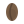

<p align="center">
  
</p>

<h1 align="center">AgroCafé</h1>

<p align="center">
  Sistema de gestión para la compra, venta e inventario de café.<br>
  Conecta administradores, campesinos y cooperativas en un solo lugar.
</p>

<p align="center">
  
  
  
  
</p>

---

## De qué se trata

AgroCafé digitaliza el día a día de un negocio cafetero: registrar compras a productores, controlar la bodega, abrir y cerrar caja, facturar, pagar y consultar precios.

Está pensado para dos perfiles:

| Perfil | Qué puede hacer |
| --- | --- |
| **Administrador** | Usuarios, caja, compras, ventas, bodega, facturas, pagos, cooperativas, tipos de café y análisis de precios |
| **Campesino / productor** | Ver sus compras, facturas y el análisis de precios; descargar PDF de sus facturas |

También expone una **API** con Laravel Sanctum para que una app móvil se conecte al mismo sistema.

## Módulos

- **Caja** — apertura, cierre y control de saldo antes de comprar
- **Compras** — registro de café adquirido a cada productor
- **Ventas** — comercialización del inventario
- **Bodega** — movimientos de inventario
- **Facturación** — generación de PDF y envío por correo
- **Pagos** — seguimiento de pagos a campesinos
- **Cooperativas y tipos de café** — catálogos del negocio
- **Análisis de precios** — consulta de precios históricos y en tiempo real

## Stack

- PHP 8.2 y Laravel 12
- MySQL
- Blade, Tailwind CSS y Alpine.js
- Vite
- Laravel Sanctum (API)
- DomPDF (facturas)

## Requisitos

- PHP 8.2 o superior (en Laragon, selecciona esa versión)
- Composer
- Node.js 18+ (recomendado 22)
- MySQL 8

## Instalación local

```bash
git clone https://github.com/PabloMartinez29/AgroCafe.git
cd AgroCafe

composer install
copy .env.example .env
php artisan key:generate
```

Crea la base de datos `agrocafe` y ajusta `DB_*` en `.env`. Luego:

```bash
php artisan migrate --seed
npm install
npm run build
php artisan serve
```

El panel queda en [http://127.0.0.1:8000](http://127.0.0.1:8000).

En desarrollo también puedes usar `composer run dev` para levantar servidor, colas y Vite a la vez.

### Usuario inicial

El seeder crea un administrador de prueba:

- **Correo:** `admin@agrocafe.com`
- **Contraseña:** `admin123`

Cámbiala después del primer inicio de sesión. No la uses en producción.

## API

Las rutas de la API viven en `routes/api.php`. La autenticación es por token Sanctum (`/api/login`). El campesino solo ve sus propios datos; el administrador ve todo el negocio.

## Pruebas

```bash
php artisan test
```

El CI de GitHub Actions corre las mismas pruebas en las ramas `main` y `develop`.

## Licencia

Proyecto académico / de gestión interna. El framework Laravel se distribuye bajo licencia MIT.
